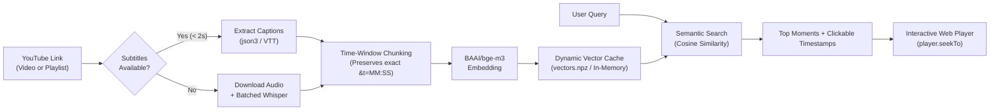

<div align="center">

# 🎬 Dynamic YouTube RAG & Video Explorer

**AI-powered semantic search, timestamped retrieval, and on-the-fly ingestion for any YouTube video or playlist.**

[](https://www.python.org/)
[](https://fastapi.tiangolo.com/)
[](https://huggingface.co/BAAI/bge-m3)
[](https://github.com/SYSTRAN/faster-whisper)
[](https://groq.com/)
[](LICENSE)

<p align="center">
  <a href="#key-features">Key Features</a> •
  <a href="#architecture">Architecture</a> •
  <a href="#quick-start">Quick Start</a> •
  <a href="#web-ui">Web UI</a> •
  <a href="#api-reference">API Reference</a> •
  <a href="#cli-usage">CLI</a>
</p>

---

</div>

## 💡 What is Dynamic YouTube RAG?

Most traditional RAG (Retrieval-Augmented Generation) applications treat videos like static text documents: they return a wall of transcribed text and leave you guessing *where* in the video it happened.

**Dynamic YouTube RAG changes that:**
1. Submit **any** YouTube video or playlist URL on the fly.
2. The pipeline extracts, chunks, and indexes it within seconds.
3. Ask questions in English,Nepali or Nepangrazi.
4. **Jump directly to the exact second (`&t=120s`) the topic was explained**, either inside the embedded web player or directly on YouTube.

```
Question: "Where is memoization vs tabulation explained?"

→ Found: DP Lecture 3 — Memoization Deep Dive @ 12:04  [▶ Jump to 12:04]
→ Found: DP Lecture 5 — Tabulation Recipe      @ 04:31  [▶ Jump to 04:31]
```

---

## ⚡ Key Features

- **🚀 Instant Dynamic Ingestion**: Paste any single video or full playlist URL. No static pre-embedding required.
- **⏱️ Sub-Second Transcript Extraction**: Automatically fetches YouTube's native manual or auto-generated subtitles in ~1-2 seconds without downloading heavy audio files. Seamlessly falls back to batched `faster-whisper` (`large-v3`) if subtitles are unavailable.
- **🎯 Exact Timestamp Preservation**: Uses a custom time-window chunking algorithm that retains `video_url`, `start_time`, and `end_time` on every chunk.
- **🧠 Dynamic AI Suggested Questions**: Automatically analyzes the video content and generates 5 contextual question chips to guide users.
- **🖥️ Interactive Web Player**: Responsive dark-mode dashboard with real-time progress tracking, ETA countdown, and one-click in-page video seeking.
- **🔍 Vector Search**: Powered by `BAAI/bge-m3` (1024-dim multilingual embeddings) for accurate semantic retrieval across mixed English and Hinglish.
- **🛠️ Dual LLM Support**: Grounded answers using Groq (`llama-3.3-70b` / `openai/gpt-oss-120b`) or Google Gemini.

---

## 🏗️ Architecture



---

## 🛠️ Tech Stack

| Layer | Technology | Description |
|---|---|---|
| **Backend Framework** | `FastAPI` + `Uvicorn` | Asynchronous REST API with CORS support |
| **Transcription** | `yt-dlp` + `faster-whisper` | Fast subtitle scraper with CTranslate2 Whisper fallback |
| **Embedding Model** | `BAAI/bge-m3` | 1024-dimension multilingual semantic embedder |
| **Vector Store** | In-Memory / `vectors.npz` / `Qdrant` | Fast vector similarity search with compressed local archiving |
| **LLM Provider** | `Groq` or `Google Gemini` | Hallucination-free grounded synthesis |
| **Frontend** | HTML5, Modern CSS, Vanilla JS | Clean dark UI with YouTube embed controls |
| **CLI** | `Typer` + `Rich` | Terminal workflows with progress bars and tables |

---

## 🚀 Quick Start

### 1. Clone the Repository

```bash
git clone https://github.com/sanuzthapa/Youtube-Context-finder-RAG.git
cd Youtube-Context-finder-RAG
```

### 2. Set Up Virtual Environment

Using **uv** (recommended for speed):
```bash
uv venv --python 3.11
uv sync
```

Or using standard **pip**:
```bash
python -m venv .venv
# Windows:
.venv\Scripts\activate
# Linux/macOS:
source .venv/bin/activate

pip install -e .
```

### 3. Configure Environment Variables

Copy the example environment template:
```bash
cp .env.example .env
```

Edit `.env` and add your free API key (only ONE is required):
```env
# Free key from https://console.groq.com/keys
GROQ_API_KEY=gsk_your_groq_api_key_here

# Or a free key from https://aistudio.google.com/apikey
GEMINI_API_KEY=
```

---

## 💻 Web UI

Launch the local web application:

```bash
python serve.py
```
*(Or via CLI: `uv run ytrag serve`)*

Open your browser at **[http://127.0.0.1:8000](http://127.0.0.1:8000)**.

1. **Step 1**: Paste any YouTube video or playlist link and click **Load Video** (or press Enter).
2. **Step 2**: Watch the progress bar index the video with real-time ETA.
3. **Step 3**: Explore the dynamically generated suggested questions, or type your own question.
4. **Step 4**: Click any matching result card to jump directly to that exact second in the player!

---

## 📡 API Reference

### 1. Ingest YouTube URL
Extracts transcripts, chunks content, generates embeddings, and pre-generates suggested questions.
```http
POST /ingest
Content-Type: application/json

{
  "url": "https://www.youtube.com/watch?v=VIDEO_ID",
  "save_index": true
}
```

### 2. Query Dynamic Index
Performs on-the-fly ingestion (if not already cached) and returns top matching timestamped video segments.
```http
POST /query
Content-Type: application/json

{
  "url": "https://www.youtube.com/watch?v=VIDEO_ID",
  "query": "when should we use dynamic programming?",
  "top_k": 5
}
```

**Response Example:**
```json
{
  "query": "when should we use dynamic programming?",
  "url": "https://www.youtube.com/watch?v=VIDEO_ID",
  "count": 5,
  "results": [
    {
      "title": "DP Lecture 1 - Overview",
      "timestamp": "04:12",
      "start_time": 252,
      "end_time": 312,
      "video_url": "https://www.youtube.com/watch?v=VIDEO_ID&t=252s",
      "similarity": 0.884,
      "preview": "We use dynamic programming when overlapping subproblems and optimal substructure exist..."
    }
  ],
  "suggested_questions": [
    "What is optimal substructure?",
    "Difference between DP and Divide & Conquer"
  ]
}
```

### 3. Health Check
```http
GET /health
```
Returns backend status and active model configurations.

---

## 🖥️ CLI Usage

You can also operate the pipeline directly from your terminal:

```bash
# Start the web server
uv run ytrag serve

# Ask a question across pre-indexed content
uv run ytrag ask "explain sliding window technique"

# Semantic search without LLM synthesis
uv run ytrag search "binary search boundary conditions"

# Batch ingest a whole playlist to local transcripts
uv run ytrag ingest --playlist "<PLAYLIST_URL>"

# Check database stats
uv run ytrag stats
```

---

## 📁 Repository Structure

```
Youtube-Context-finder-RAG/
├── api/
│   ├── main.py              # FastAPI endpoints & CORS configuration
│   └── static/
│       └── index.html       # Single-page interactive frontend & player
├── ytrag/
│   ├── __init__.py
│   ├── answer.py            # Grounded synthesis & question generation
│   ├── chunk.py             # Timestamp-preserving time-window chunking
│   ├── cli.py               # Typer CLI application
│   ├── config.py            # Application settings & environment loader
│   ├── embed.py             # SentenceTransformer embedder & vector index
│   ├── index.py             # Qdrant client & vector search helpers
│   ├── models.py            # Video, Segment, and Chunk dataclasses
│   ├── playlist.py          # yt-dlp playlist resolving & audio downloader
│   ├── transcribe.py        # Fast caption fetcher & Whisper fallback
│   └── util.py              # Exponential backoff retry helpers
├── .env.example             # Template for API keys
├── .gitignore               # Strict exclusion of .env, vectors.npz, and caches
├── pyproject.toml           # Project metadata and dependencies
├── README.md                # Project documentation
├── serve.py                 # Direct FastAPI runner
└── uv.lock                  # Pinned dependency lockfile
```

---

## 🔒 Security & Privacy

- All private credentials (`GROQ_API_KEY`, `GEMINI_API_KEY`, etc.) are read strictly from local `.env` files.
- `.gitignore` is configured to prevent accidental commits of secrets, local virtual environments (`.venv`), or runtime binary vector indices (`vectors.npz`).

---

## 📄 License

This project is licensed under the **MIT License** — feel free to use, modify, and distribute it for personal and commercial projects.
